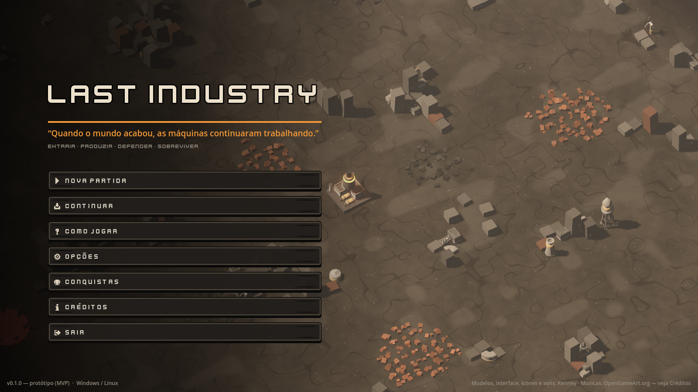
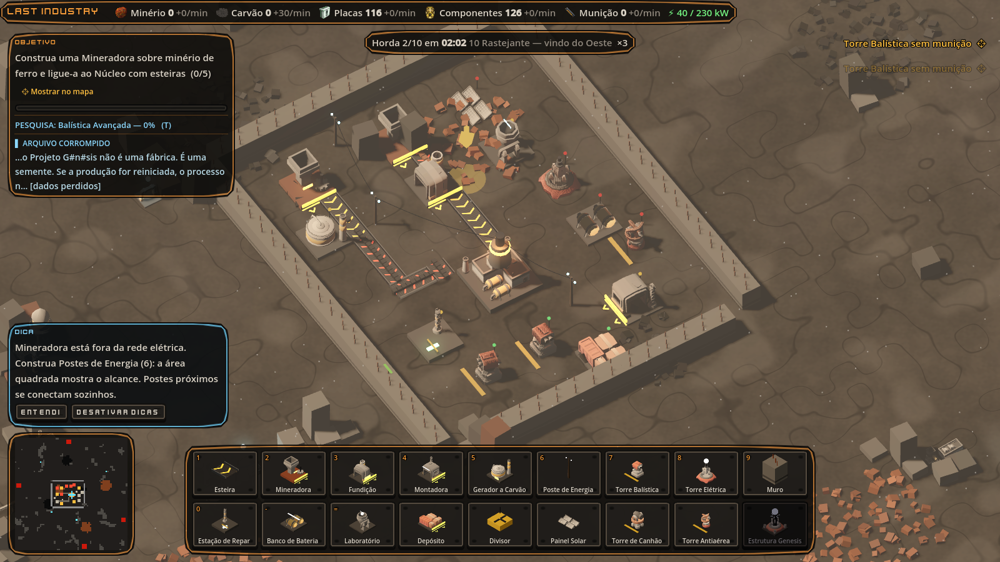
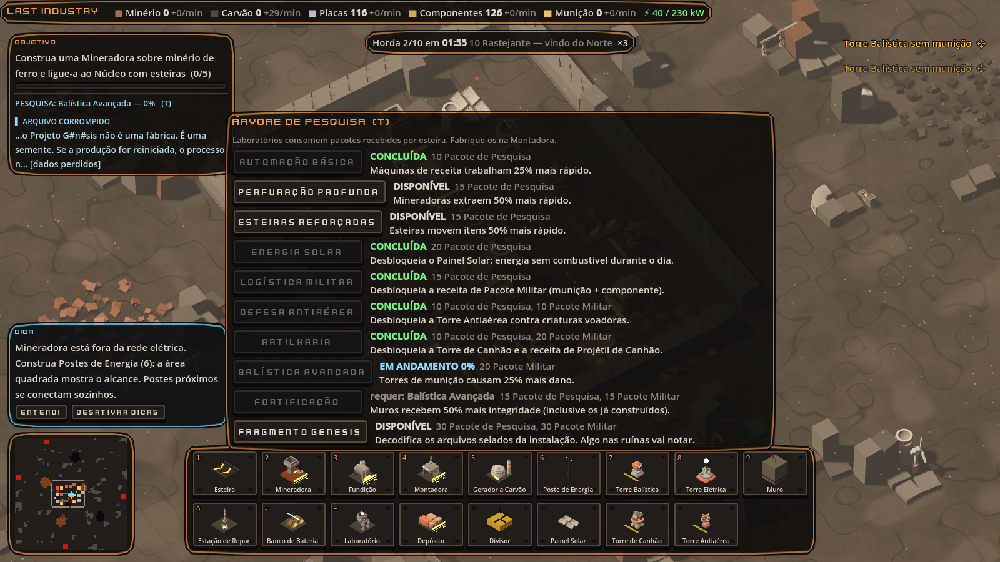
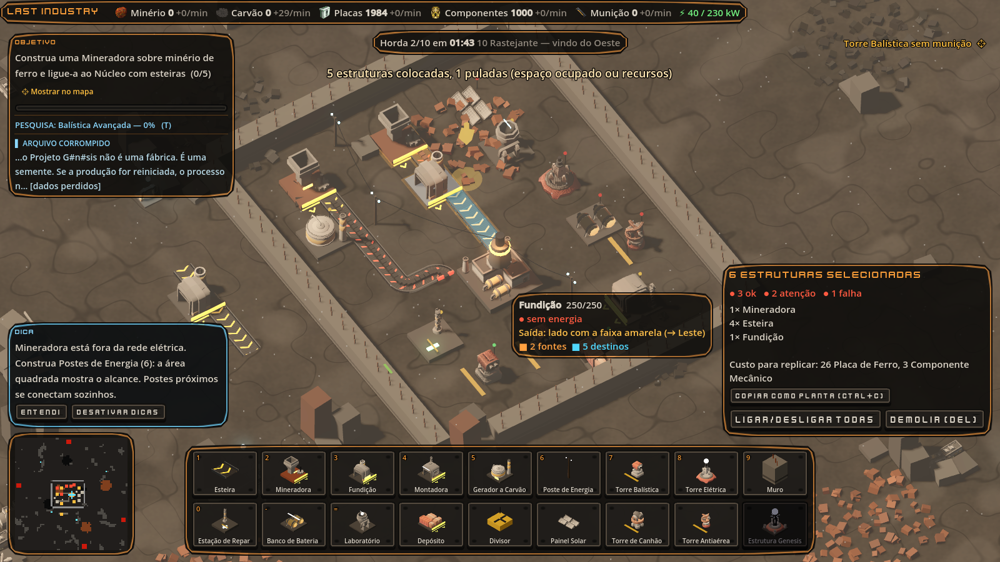
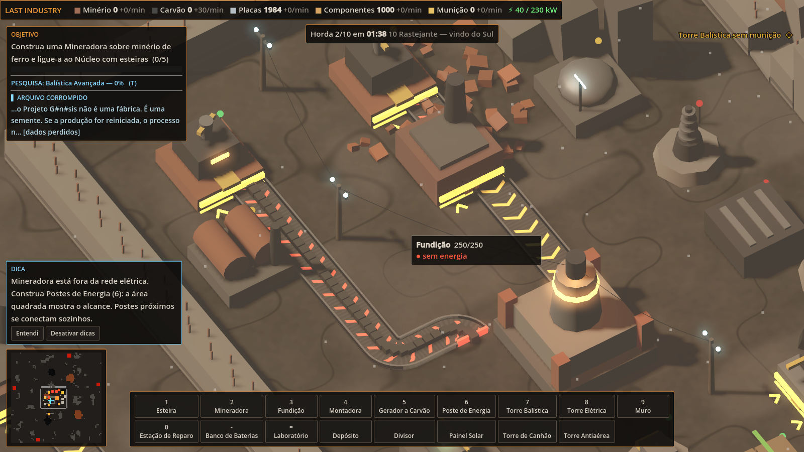

# LAST INDUSTRY

> *“Quando o mundo acabou, as máquinas continuaram trabalhando.”*
>
> **Extrair. Produzir. Defender. Sobreviver.**

Estratégia, automação industrial e tower defense em um mundo pós-apocalíptico. Você reativa um
complexo industrial esquecido, automatiza cadeias produtivas e defende o **Núcleo** de hordas que
surgem quando as máquinas despertam. A defesa é sustentada pela própria indústria: cada bala
precisa ser fabricada, cada torre consome energia, cada reparo custa materiais.







**Plataformas:** Windows e Linux (x86_64) · **Engine:** Godot 4.3 (GDScript) · **Modo:** solo, offline · **Destino:** Steam

## Estado atual: Fases 1 a 8 (MVP, pesquisa, ferramentas, desempenho e preparação para a Steam)

| Item do MVP | Implementado |
|---|---|
| Mapa funcional | Mapa procedural 72×72 com ruínas, jazidas e 4 ninhos |
| Dois recursos minerais | Minério de ferro e carvão (jazidas finitas) |
| Mineração | Mineradora 2×2 sobre jazida |
| Esteiras | Esteiras direcionais, divisor, depósito-buffer, arraste para traçar |
| Duas máquinas | Fundição (minério → placa) e Montadora (munição / componentes) |
| Cadeia de munição | minério + carvão → placa → pente de munição → torre |
| Energia | Núcleo, gerador a carvão, postes, baterias, redes independentes, prioridade defesa > produção |
| Duas torres | Torre Balística (munição física) e Torre Elétrica (energia, descarga em cadeia) |
| Muros e reparos | Muro, Estação de Reparo (consome placas) |
| Três inimigos | Rastejante, Corredor, Aríete (+ variante elite/chefe) |
| Ondas | 10 hordas anunciadas (composição, direção, contagem regressiva) + patrulhas sem aviso + modo Sobrevivência |
| Destruição e reconstrução | Estruturas destruídas viram ruínas reconstruíveis (clique ou **G**) |
| Vitória / derrota | Sobreviver à 10ª horda / Núcleo destruído |
| Interface de produção e alertas | HUD, inspetor, estatísticas por minuto, diagnóstico de gargalos, alertas, luzes de estado |
| Salvamento local | F5 / F9, determinístico |
| Ciclo completo | Menu → partida → hordas → vitória/derrota → sobrevivência |

**Fase 6:** Laboratório e árvore de 10 tecnologias (T) alimentada por Pacotes de Pesquisa e Militares;
Torre de Canhão (dano em área), Torre Antiaérea, Painel Solar (fraco à noite); novos inimigos
Sabotador (caça infraestrutura) e Planador (voa sobre muros); modificadores de mineração, máquinas,
esteiras, dano e muros; hordas e patrulhas que reagem ao avanço da pesquisa.

**Fase 7:** seleção em área com ações em grupo, plantas (copiar, girar e colar grupos de estruturas),
rastreamento da origem e do destino dos itens, minimapa clicável, alertas que levam a câmera ao
problema, dicas contextuais, menu de opções salvo entre sessões e otimização para bases com
milhares de estruturas.

**Fase 8:** pipeline de release (pacotes versionados, GitHub Release por tag, upload Steam pelo CI),
integração Steam opcional via GodotSteam, 12 conquistas, Rich Presence e remapeamento de teclas.

Também incluídos: objetivos guiados com recompensas, narrativa por transmissões e arquivos
corrompidos, sobreposição de depuração (F3: rotas, redes elétricas, alvos), áudio procedural.

## Como jogar

Baixe os builds do último run de CI (artefatos `LastIndustry-windows` / `LastIndustry-linux`) ou
rode pelo editor:

1. Instale o [Godot 4.3](https://godotengine.org/download/archive/4.3-stable/) (versão padrão, não .NET).
2. Abra `project.godot` no editor e pressione **F5**.
   Ou via terminal: `godot --path .`

### Controles

| Ação | Tecla |
|---|---|
| Mover câmera | WASD / setas (Shift acelera) · botão do meio arrasta |
| Zoom / girar câmera | Roda do mouse / Z e C |
| Escolher estrutura | 1–0, -, = ou barra inferior |
| Construir / girar | Clique esquerdo (arraste para esteiras, muros, postes) / R (Shift+R inverte) |
| Demolir | Clique direito (arraste para várias) · Del na seleção |
| Conta-gotas / copiar e colar configuração | Q / Ctrl+C, Ctrl+V |
| Selecionar área / copiar como planta / reutilizar planta | Shift+arrastar / Ctrl+C na seleção / B |
| Rastrear fluxo de itens | V (passe o mouse sobre uma estrutura) |
| Reconstruir ruínas | G |
| Pausar / velocidade / chamar horda | Espaço / . e , (ou + − do numérico) / N |
| Remapear teclas | Opções › Controles |
| Estatísticas / pesquisa / ajuda / depuração | Tab / T / H / F3 |
| Salvar / carregar / menu | F5 / F9 / Esc |

### Primeiros passos

1. Coloque uma **Mineradora** sobre o minério de ferro (pedras alaranjadas). O lado com a **faixa
   amarela** é a saída. Arraste esteiras a partir dele até uma **Fundição** e depois até o Núcleo.
   Desenhe em L para fazer curvas: a esquina vira curva sozinha. As setas animadas mostram o sentido;
   um fim vermelho indica esteira sem destino.
2. Minere **carvão**, passe a esteira encostada em um **Gerador** (ele puxa o combustível sozinho).
3. Alimente uma **Montadora** com placas e carvão para produzir **munição**.
4. Passe a linha de munição **ao lado** das Torres Balísticas: elas puxam os pentes da esteira.
5. Feche brechas com muros e mantenha uma Estação de Reparo abastecida. A primeira horda chega em 6 minutos.
6. Construa um **Laboratório** e alimente-o com Pacotes de Pesquisa. Pesquise **Defesa Antiaérea**
   antes da 6ª horda, quando chegam os Planadores.

## Desenvolvimento

```bash
# Testes (unidade + integração + desempenho), headless
GODOT=/caminho/para/godot tests/run.sh

# Teste de fumaça: executa o ciclo completo do jogo (menu, construção, horda, salvar, carregar)
godot --headless --path . -- --smoke

# Builds
godot --headless --path . --export-release "Linux" build/linux/LastIndustry.x86_64
godot --headless --path . --export-release "Windows Desktop" build/windows/LastIndustry.exe
```

O CI (`.github/workflows/ci.yml`) roda os testes e o teste de fumaça, gera os builds de Windows e
Linux e testa o binário Linux exportado a cada push.

### Releases

`git tag v0.2.0 && git push origin v0.2.0` publica um GitHub Release com os pacotes de Windows e
Linux. Para a Steam, veja [docs/STEAM.md](docs/STEAM.md): o upload pelo CI liga sozinho quando o App ID
e os segredos da sua conta Steamworks forem configurados.

### Documentação

- [Documento de design (GDD) e narrativa](docs/GDD.md)
- [Arquitetura e sistemas](docs/ARQUITETURA.md)
- [Decisão de engine (ADR 0001)](docs/adr/0001-engine-godot.md)
- [Roteiro por fases e critérios de conclusão](docs/ROADMAP.md)
- [Preparação para a Steam](docs/STEAM.md)

### Ajustar o conteúdo

Máquinas, receitas, torres, inimigos, hordas, objetivos e textos narrativos ficam em `data/*.json`.
Nada disso exige alterar código.
